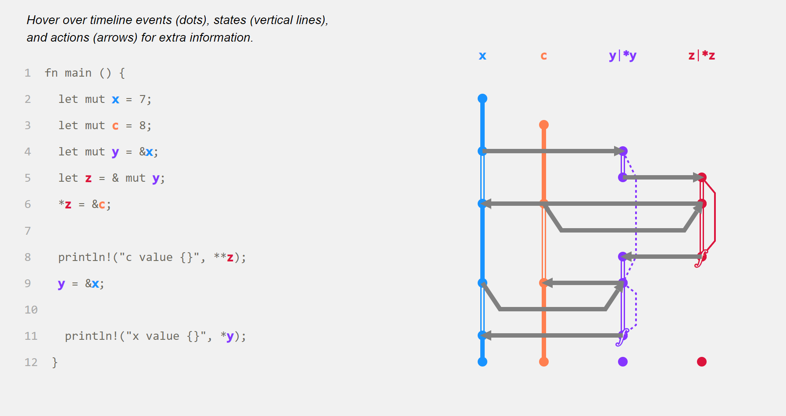

# RustViz

**RustViz** generates interactive timeline visualizations of ownership and
borrowing for short Rust programs. It is meant as a teaching aid: paste a
snippet and see exactly when each binding becomes the resource owner, when
references go in and out of scope, and which lines those events correspond
to.

This repository is now the compiler-integrated rewrite. Earlier
versions of RustViz, deployed in the classroom and described in [our VL/HCC 2022 paper](https://web.eecs.umich.edu/~comar/rustviz-vlhcc22.pdf), read hand-annotated source; this one plugs into `rustc`
directly and walks HIR/MIR, so the diagram reflects the real borrow
checker's view of the program rather than a hand-curated approximation.

> Looking for the original (annotation-based) RustViz? It lives on
> the [`rv1-final`](https://github.com/rustviz/rustviz/tree/rv1-final)
> branch and tag in this repo, with a matching
> [GitHub Release](https://github.com/rustviz/rustviz/releases/tag/rv1-final).

RustViz is a project of the [Future of Programming Lab](https://fplab.mplse.org/)
at the University of Michigan.

> **Try it live:** <https://rustviz.github.io/>



---

## Local setup

The CLI, mdbook preprocessor, and library all share a runtime
dependency on the rustc plugin built from this workspace, which links
against `rustc_private` and so requires a specific nightly toolchain.
The fastest way to get a working install is:

```sh
cargo install rustviz-cli   # the `rustviz` CLI binary
rustviz init                # installs nightly-2026-05-01 + the plugin
```

`rustviz init` runs the underlying `rustup toolchain install` + `cargo
install` against the canonical RustViz repo; pass `--dry-run` to see
exactly what it would do, or `--plugin-git` / `--plugin-rev` to install
from a fork. See `rustviz init --help` for the full flag list.

**Building from this checkout instead** (e.g. you're contributing):

```sh
git clone https://github.com/rustviz/rustviz
cd rustviz
cargo xtask setup          # toolchain + plugin install + frontend build + runner image
```

`cargo xtask setup` is the canonical bootstrap for working *on* RustViz;
it sets up everything you need to run any of the four entry points below
plus the playground's React frontend. To undo it, run `cargo xtask
uninstall` (see `--help` for what it touches and what it leaves alone —
by default it spares the rustup toolchain and the cargo `target/`
tree). The xtask driver is pure Rust, so it works the same on Linux,
macOS, and Windows.

### Working from multiple checkouts in parallel

If you keep several clones around (e.g. one branch per agent or per
issue), they share `~/.cargo` by default — so `cargo xtask setup`'s
`cargo install` from each one races for `~/.cargo/bin/rustviz`, and
concurrent playground builds collide on the `rustviz/rustviz-runner`
docker tag. To isolate them, this repo ships an
[`.envrc.example`](.envrc.example) for [direnv](https://direnv.net/)
that gives each checkout its own `CARGO_HOME` (and optional knobs
for the docker tag and playground bind address):

```sh
brew install direnv
echo 'eval "$(direnv hook zsh)"' >> ~/.zshrc   # then restart your shell
cp .envrc.example .envrc
direnv allow
```

After that, any shell — and anything it launches, including `claude`
— inherits a per-clone cargo home automatically when you `cd` into
the checkout. The rustup toolchain stays shared across clones since
they all pin the same nightly.

---

## Four ways to use RustViz

### 1. The playground

The hosted playground lets you paste a snippet into a CodeMirror editor and
get back the visualization with no local install. Available at
<https://rustviz.github.io/>; the SPA loads from GitHub Pages
and the compile API is on Google Cloud Run. You can also run the same playground
locally — it's the [`playground/`](playground/) crate in this workspace.

See [`playground/README.md`](playground/README.md) for the local quick-start
and the operational notes for the production deploy.

### 2. The mdbook preprocessor

Embed RustViz visualizations directly in an [mdBook](https://rust-lang.github.io/mdBook/)
by tagging code blocks with ` ```rv ` instead of ` ```rust `. The
preprocessor compiles each snippet through the plugin at build time and
inlines the resulting SVGs into the rendered HTML, with tooltip glue for
hover-driven exploration.

```toml
# book.toml
[preprocessor.rustviz]
```

````markdown
```rv
fn main() {
    let s = String::from("hello");
    println!("{}", s);
}
```
````

See [`mdbook-rustviz/README.md`](mdbook-rustviz/README.md) for setup
instructions and `mdbook-rustviz/test-book/` for a small worked
example. The hands-on Rust tutorial at
<https://github.com/rustviz/tutorial> (deployed at
<https://rustviz.github.io/tutorial/>) is a full-scale example built
this way.

### 3. The command-line interface

For one-shot rendering of a single `.rs` file:

```sh
cargo install rustviz-cli       # the `rustviz` binary
rustviz init                    # one-time: install nightly + plugin

rustviz svg foo.rs              # writes foo.code.svg + foo.timeline.svg
rustviz html foo.rs             # writes one self-contained HTML page
```

`svg` is for embedding into your own HTML/Markdown workflow. `html`
produces a single self-contained file with both SVGs inlined and the
tooltip JS embedded — opens in any browser, no server, no external
assets. See `rustviz init --help` for the bootstrap flags.

### 4. The Rust library

For programmatic SVG generation (e.g. wiring RustViz into your own
authoring pipeline), `rustviz-lib` exposes a small Rust API:

```rust
use rustviz_lib::Rustviz;

let rv = Rustviz::new(code)?;     // calls the plugin under the hood
fs::write("code.svg", rv.code_panel_string())?;
fs::write("timeline.svg", rv.timeline_panel_string())?;
```

A runnable example lives at
[`rustviz-lib/examples/render_to_files.rs`](rustviz-lib/examples/render_to_files.rs).
The crate's [API docs](rustviz-lib/src/lib.rs) cover the backend split
(local subprocess vs. sandboxed Docker — `local` is the default for
library use; the playground binary opts into `docker` for untrusted
input).

---

## Repository layout

The workspace is organized around the four entry points above. Each
top-level directory:

| Path                  | Contents |
|-----------------------|----------|
| **`rustviz-plugin/`** | The rustc plugin — the heart of the project. Walks HIR/MIR for a single-file crate and emits a code-panel + timeline-panel SVG on stdout. Built on Will Crichton's `rustc_plugin` / `rustc_utils` crates (same family as Flowistry / Aquascope). Produces the `cargo-rv-plugin` and `rv-plugin-driver` binaries. Pinned to nightly-2026-05-01 via `rust-toolchain.toml`. Published to crates.io as **`rustviz-plugin`**. |
| **`rustviz-lib/`**    | User-facing Rust library. Exposes `Rustviz::new(code)` which shells out to the plugin and returns the two SVGs. The shared tooltip JS for hover behavior also lives here, exported as `rustviz_lib::HELPERS_JS`. Published to crates.io as **`rustviz-lib`**. |
| **`rustviz-cli/`**    | The `rustviz` command-line interface — `rustviz svg`, `rustviz html`, `rustviz init`. Wraps `rustviz-lib` with file I/O + self-contained-HTML output, plus a one-shot toolchain/plugin bootstrap (`init`). Published to crates.io as **`rustviz-cli`**. |
| **`mdbook-rustviz/`** | An [mdBook](https://rust-lang.github.io/mdBook/) preprocessor. Replaces ` ```rv ` fenced code blocks with embedded RustViz SVGs at build time. Includes a `test-book/` worked example. The full hands-on tutorial that uses it is in a [separate repo](https://github.com/rustviz/tutorial). Published to crates.io as **`mdbook-rustviz`**. |
| **`playground/`**     | The web playground: Actix-web backend + a Vite/React/CodeMirror frontend. Hosted at <https://rustviz.github.io/> with the compile API at <https://rustviz-api-816769776225.us-central1.run.app/>. The same binary works as an all-in-one server for local dev. The per-request Docker sandbox image, deploy artifacts, and security threat model all live alongside it under `playground/`. Not published to crates.io. |
| **`xtask/`**          | Cross-platform driver for `cargo xtask setup` / `cargo xtask uninstall`. Installs the plugin + CLI, builds the frontend, pulls/builds the docker runner image; the uninstall subcommand reverses each step (with optional `--toolchain` / `--target` / `--everything` flags). Replaces the legacy bash scripts so the workspace boots the same way on Linux, macOS, and Windows. Not published. |
| `scripts/bump-version.sh` | Synchronizes the version field across all four published crates' Cargo.toml files (and refreshes Cargo.lock). Run before tagging a release; see "Releasing" below. |

---

## Limitations

RustViz 2 is a research / teaching tool. It handles a meaningful subset
of Rust, and some of what it draws is simplified or wrong. This list is
checked against a corpus of Rust Book–style snippets; see the [issues
tab](https://github.com/rustviz/rustviz/issues) for tracked work. It's
mirrored in the playground's "Known limitations" panel
(`playground/frontend/src/App.tsx`); keep the two in sync.

**Only programs that compile.** RustViz visualizes programs that pass
the borrow checker. Code with a borrow error (e.g. two simultaneous
`&mut` borrows) is rejected with rustc's error rather than drawn, under
the heading "This program doesn't compile". A program that compiles but
hits one of the crashes listed below is reported as "RustViz can't
visualize this program yet", with a link to report it, instead of a raw
panic.

**Renders, but some of what's shown is wrong:**

- A reference bound by a pattern out of a value that holds a borrow
  (`Some(x)` in a `match` on `let third = v.get(2);`) isn't linked to
  `v`. (A reference or a value returned by a call *is* drawn as
  borrowing what the callee's signature ties it to: `first_word(&s)`,
  `longest(&a, &b)`, `let it = v.iter();`, `let third = v.get(2);`,
  `it.next().unwrap()`, `Excerpt::new(&novel)`. Through a reference
  parameter `v: &Vec<i32>`, `v.iter()` is drawn as borrowing from `v`,
  whose column stands for the caller's data, as for `&v[0]`.)
- A collection filled with references by a method whose signature
  ties the stored value to the collection only through a trait bound
  (`refs.extend([&s])`), or by another function through a `&mut`
  (`add(&mut refs, &s)`), isn't drawn as borrowing `s`. (`vec![&s]`,
  `[&a, &b]`, `collect()` (`let words: Vec<&str> =
  s.split(' ').collect();`), `refs.push(&s)` on a local `refs`, and a
  reference copied out of them, `refs[0]`, are.)
- A reference returned by a call in one branch of an `if` / `match`
  that initializes a variable (`let w = if c { first_word(&s) } else {
  "none" };`) isn't linked to `s`.
- A variable assigned in only some branches (`let mut s; if c { s = …
  }`) is drawn as owning a value after the `if`, and a later `s = …` as
  dropping the old value; Rust drops it only on paths that assigned it.
- A reference field of a struct bound by a pattern (`if let Some(x) =
  o` with `x.part: &str`) is drawn as owning a resource.
- `Rc` / `Arc` / `Weak`: reference counts aren't modelled. Each clone is
  drawn as its own owner; its scope end says that its resource is dropped
  and adds that, for an `Rc`, this lowers the reference count and the
  shared value is freed only when its last `Rc` is dropped, without saying
  which one that is (a `Weak` doesn't keep the value alive). This applies
  to a variable or struct field whose own type is `Rc` / `Arc` / `Weak`,
  and to a struct whose only droppable fields are of one such type. A
  value whose only droppable contents are handles of one kind inside
  `Option`, `Box`, `Cell`, `RefCell`, tuples, arrays or `Vec` / `VecDeque`
  / `HashMap` / `BTreeMap` (`Option<Rc<T>>`, `Vec<Rc<T>>`) says that the
  `Rc` inside only lowers its reference count (and, for a collection, that
  its own buffer is freed). A type that also owns other droppable data
  (`Vec<(Rc<T>, String)>`, `HashMap<String, Rc<T>>`), has its own `Drop`
  impl, or mixes `Rc` and `Arc` keeps the plain wording.
- A closure that uses one field or element (`move || p.name.len()`,
  `move || t.0.len()`) is drawn as capturing the whole variable, so its
  other fields are shown as moved.

**Crashes the plugin:** some valid programs do. The playground then shows
"RustViz can't visualize this program yet" with a link to report it.
Known crashes are tracked as [issues labelled
`crash`](https://github.com/rustviz/rustviz/issues?q=is%3Aissue+is%3Aopen+label%3Acrash)
rather than listed here.

**Simplified or not shown:**

- Smart pointers (`Box`, `Rc`, `Arc`, `RefCell`, `Mutex`), trait
  objects and unions render as a single owner column (a union's field
  reads, writes and borrows are drawn on the union's column);
  `RefCell`'s runtime borrows aren't shown, and a write through one
  (`*cell.borrow_mut() += 1`) shows only the `borrow_mut` call (a shared
  borrow of `cell`), not the write itself.
- Closures: captures are shown; events inside the closure body aren't.
  For a closure passed straight to a function (`thread::spawn(move ||
  …)`), what it captures by value is drawn as moved / copied into the
  call. What it captures by reference (`apply(|x| x + k)`) is drawn as
  borrowed by "the closure passed to apply" for the call, when the
  closure is gone by the end of the call. When the callee keeps the
  closure (`let g = keep(|| s.len());`, an iterator adapter stored for
  later), or the capture is through a reference (`|| r.len()` with
  `r: &String`), that borrow isn't drawn.
  Calling a closure that can only be called once (`f()` with `let f =
  || drop(s);`) moves `f`, and the call's tooltip says what happens to
  each value `f` captured by value: dropped, or returned as the call's
  result, when the body shows that (`drop(s)`, `s` as its last
  expression, or `s` untouched). If the body moves it on to another
  function, or the body has a branch, it only says the call "moved on or
  dropped" it.
- Loops (`for`, `while`, `loop`) show a single iteration. A `for`
  loop's variable is drawn bound at the `for` line and going out of
  scope at the body's closing brace, like the body's own `let`s; Rust
  creates it afresh each iteration.
- Leaving a function early drops every value it still owns, where it
  leaves. That's drawn for a `return` that ends an `if`/`else` branch
  or a `match` arm, but not for `panic!()` / `unreachable!()` (the
  values are dropped while the panic unwinds), `break` / `continue`
  (locals declared inside the loop are dropped), a `return` in an `if`
  without `else`, or a variable used in the returned expression
  (`return s.len()` drops `s`).
- Method chains (`v.iter().map(f).collect()`): only the first call
  has `v` as its receiver and is drawn on `v`'s column. Each later
  call's receiver is the previous call's result, a temporary with no
  column, so it's drawn only through its arguments
  (`v.last_mut().unwrap().push(s)` moves `s`).
- Match guards (`pat if cond =>`, `pat if let … =>`): the guard's events
  are drawn in its own arm, since it only runs once that arm's pattern
  has matched. When the guard is false and a later arm runs, the guard
  still ran first, but the later arm's column doesn't show it.
- `if let` chains in an `if` condition (`if let Some(a) = x && let
  Some(b) = y`): the bindings and their uses aren't shown.
- Assignments to a place that has no column of its own are drawn on
  the column of the variable the place is reached from, like an
  element write: a tuple field
  (`t.0 = …`), a field of a method's result
  (`v.last_mut().unwrap().n = 5`). The tooltip reads like a plain
  assignment (the place is the subject) and says the previous resource
  is dropped when its type needs drop, but the drop is not drawn on a
  column. Not drawn: a place that holds
  a reference (`v[i] = &s`, `h.r = &x`: overwriting a reference drops
  nothing), and a place not reached from a local variable. A value
  moved into such a place is still shown as moved, and a borrow stored
  in one (`v[i] = &s`, `h.r = &s`) is drawn on the lender's column
  only, naming the place as the borrower ("borrowed by h.r"; "borrowed
  by hold.r" for `rh.r = &s` after `let rh = &mut hold;`, though no
  arrow goes into `hold.r`'s column). It ends where the borrow checker
  ends it; one stored behind a reference parameter (`h: &mut Holder`)
  outlives the function, so no end is drawn. The same holds for a
  borrow passed to a function whose signature lets it store the
  reference behind another argument (`point(&mut hold, &s)` with
  `fn point<'a>(h: &mut H<'a>, t: &'a String)`): it lasts until
  `hold`'s last use, drawn on `s`'s column only. Fields of a local
  struct, including chained ones (`o.inner.x = …`), have columns of
  their own. Overwriting a reference field of a local struct
  (`hold.r = &t` after `H { r: &s }`) keeps `s` borrowed until the
  struct's last use, as the borrow checker does (the struct's type has
  one lifetime for the reference). Overwriting the whole struct
  (`hold = H { r: &t }`) ends the old borrow at the write in rustc but
  isn't drawn ending at all (#538).
- A write to an element (`v[i] = x`, `grid[r][c] += 1`, `r[i] = x`
  through `r: &mut Vec<_>`) is drawn on the collection's column; an
  assignment reads like a plain assignment with the element as the
  subject, an in-place update (`+=`) as a modification of the
  collection's resource. Elements have no columns of their own, so the
  element value an assignment replaces is dropped only in words (the
  tooltip says "v[0] acquires ownership of a new resource; its previous
  resource is dropped"), not on a column.
  A write through a reference or `Box` stored in an element
  (`*slots[0] += 10` with `slots: Vec<&mut i32>`) is drawn there too,
  as a modification of what `slots[0]` points to; the variable it
  points to isn't shown changing.
  A read through one (`let n = *slots[0];`) is an arrow out of the
  collection's column naming the element ("Copy from *slots[0] to n"),
  again without showing which variable it comes from.
- A write to a field through a reference (`self.n += 1` in a `&mut
  self` method, `c.n = …` where `c: &mut T`) is drawn on the
  reference's column, not on the column of the struct it borrows from.
  An assignment reads like a plain assignment with the field as the
  subject ("c.n is assigned a new value"); an update like `+=` says
  "the resource c points to is modified through c.n". When the
  assignment replaces a value that needs drop (a `String` field), the
  tooltip says "its previous resource is dropped". When the
  reference borrows a local struct (`let r = &mut s; r.a = …`), `s.a`
  also shows its previous resource dropped on its own column, but not
  inside an `if`/`match` arm or through a reborrow (`let r2 = &mut *r;`);
  a parameter's struct belongs to the caller, so no column shows it.
  Reads and borrows through a reference (`let a = p.x;`, `&p.name`,
  `&mut r.a`, `r.a.push_str(..)`) are drawn on the reference's column
  the same way; a write through such a borrow (`let f = &mut r.a; *f =
  …`) drops the old value on `s.a`.
- `let first = v[0];` (copying out of an index) shows nothing; reading
  tooltip says "its previous resource is dropped"; the field has no
  column to draw that on.
- Arrays and `Vec`s are one column each: `let a = [s, t];` and
  `vec![s, t]` draw `s` and `t` moved into `a`, and `let first =
  v[0];` draws a copy out of `v[0]` on `v`'s column. Reading
  through `&v[i]` and slicing (`&v[..]`, `&s[..]`) work.
- `async` / `await` aren't visualized.
- User-defined macros (`macro_rules!`) that use a variable are refused
  with "can't visualize this program yet" rather than drawn, since
  what the macro does to the variable (`take!(z)` expanding to
  `drop(z)`) isn't modelled. Standard-library macros like `println!`,
  `vec!`, `assert!` are unwrapped, and a user macro that only forwards
  a variable to one of them (`show!(w)` → `println!`) is shown as that
  read; a macro that uses no variable renders.
- A `for` loop variable taken from a range or a call (`for i in 0..n`,
  `for c in s.chars()`) has no start or end on its timeline, only the
  reads in the body.
- A reference to a non-Copy value with nothing to drop (`&[i32]`,
  `&str`) still reads "the resource xs points to" in tooltips; only a
  Copy referent reads "value" (#549).
- Raw pointers aren't modelled: `let p = &mut x as *mut i32;` shows no
  borrow of `x`, so a write `*p = 2` isn't connected to `x`.
- `const` and `static` items get no column of their own; reading one
  shows only the binding it's read into.
- A `ref` binding in a by-value parameter (`fn f(ref s: String)`) is
  drawn as a borrow of the value `f` owns, but that value has no column
  of its own, so its drop when `f` returns is stated only in the
  binding's tooltip ("...; that value is dropped when f returns").
- A reference field of a struct bound by a pattern (`if let Some(x) =
  o` with `x.part: &str`) is drawn as a reference, but not linked to
  what it borrows (whatever `o`'s field borrowed), and neither is a
  reference copied out of it (`let q = x.part;`).
- A pattern in a function parameter (`fn f((a, b): (String, i32))`)
  gives its names no columns.
- Temporaries: a temporary that a `let` borrows (`let r =
  &String::from("a");`) lives until the end of the block, so it gets
  a column labelled `(temporary)` that is dropped there. A call's
  result that nothing binds or moves on (`make();`, `let _ = make();`,
  `make().len()`, `f(&make())`, a `match` scrutinee) gets a short
  `(temporary)` column too (numbered in one sequence with the others:
  `(temporary 2)`, ...), dropped where Rust drops it. Left out
  (their drops are not stated): temporaries that aren't a call's result
  (`vec![..];`, `format!(..);`, a struct literal), the scrutinee of
  `if let` / `while let`, a `for` loop's head (`for x in make().iter()`),
  a field moved out of a temporary (`make().name`), a `match`
  scrutinee some arm binds by value, and a temporary nested inside a
  borrowed value (`let p = Wrapper { r: &String::new() };`).
  Temporaries with nothing to drop (`&Point { x: 4 }`) get no column.

The plugin has its own per-feature TODO checklist in
[`rustviz-plugin/README.md`](rustviz-plugin/README.md).

---

## Security

The playground compiles untrusted Rust source. Snippets are compiled as a
dependency-free library crate, so they can't run code at compile time
without a rustc bug, but rustc is a large attack surface: every request runs
in a per-request sandbox (Cloud Run's `sandbox do` in production, a locked-
down container locally). The full threat model and operator
checklist are in [`playground/SECURITY.md`](playground/SECURITY.md). Report findings to
`comar@umich.edu`.

---

## Contributing

Issues and PRs welcome. Keep each PR focused on a single concern; for
local-dev setup run `cargo xtask setup` then `cargo build --workspace --locked`.
[`CLAUDE.md`](CLAUDE.md) has the project's ground rules (for human and AI
contributors alike): tooltips must be semantically correct, tests must pin
correct behaviour, and the limitations lists stay in sync.

CI also lints the plugin for iteration over a `HashMap` / `HashSet`, whose
order changes from run to run (#211). To run that lint locally:

```sh
rustup component add clippy
cargo clippy -p rustviz-plugin --locked -- -A clippy::all -D clippy::disallowed_methods -D clippy::iter_over_hash_type -D unfulfilled_lint_expectations
```

If the order can't reach the output (a sum, a set union, a lookup), mark
the statement with `#[expect(clippy::..., reason = "...")]`; otherwise sort
first or use a `BTreeMap` / `BTreeSet`.

## Releasing

Four crates are published to crates.io in lockstep, all sharing the
same version:

| Crate                                                            | What it is |
|------------------------------------------------------------------|------------|
| [`rustviz-plugin`](https://crates.io/crates/rustviz-plugin)      | The rustc plugin (binaries `cargo-rv-plugin` + `rv-plugin-driver`). |
| [`rustviz-lib`](https://crates.io/crates/rustviz-lib)            | Rust library: `Rustviz::new(code)` returns the SVGs. |
| [`rustviz-cli`](https://crates.io/crates/rustviz-cli)            | The `rustviz` CLI binary (`svg`, `html`, `init`). |
| [`mdbook-rustviz`](https://crates.io/crates/mdbook-rustviz)      | The mdBook preprocessor. |

Versions follow `v2.Y.0` (major fixed at 2 to match RustViz 2; patch
fixed at 0 since the four crates always release together — bumping Y
covers everything from a typo fix to a breaking API change). To cut a
release:

```sh
# 1. Bump versions on a branch, open a PR, get it reviewed + merged.
./scripts/bump-version.sh         # auto-increment Y
# (or: ./scripts/bump-version.sh 5  to set v2.5.0 explicitly)
git checkout -b release/v2.5.0
git add -A && git commit -m 'Bump RustViz to v2.5.0'
git push -u origin release/v2.5.0
gh pr create --fill                # land it on main

# 2. Once the bump PR is merged, tag the merge commit and push the tag.
#    Merging the PR does NOT auto-tag — tagging is a separate, deliberate
#    step so you have a clean "yes, ship this" checkpoint.
git checkout main && git pull
git tag v2.5.0
git push origin v2.5.0
```

The pushed `v2.Y.0` tag triggers
[`.github/workflows/publish.yml`](.github/workflows/publish.yml), which
verifies all four manifests pin the tag's version and then publishes
them in dependency order (`rustviz-plugin` and `rustviz-lib` first,
then `rustviz-cli` and `mdbook-rustviz`). A `CRATES_IO_TOKEN` repo
secret with `publish-new` + `publish-update` scope on those four crate
names is required.

## Credits

RustViz is a project of the
[Future of Programming Lab](https://web.eecs.umich.edu/~comar/) at the
University of Michigan. The plugin is built on
[`rustc_plugin`](https://github.com/cognitive-engineering-lab/rustc_plugin) /
[`rustc_utils`](https://github.com/cognitive-engineering-lab/rustc_plugin)
by [Will Crichton](https://willcrichton.net/), and ports several
MIR / borrow-fact helpers from
[Aquascope](https://github.com/cognitive-engineering-lab/aquascope)
(another visualization tool for Rust) by
[Gavin Gray](https://gavinleroy.com/).

## License

[MIT](LICENSE).

## Citing

If you use RustViz in academic work, please cite the
[VL/HCC 2022 paper](https://web.eecs.umich.edu/~comar/rustviz-vlhcc22.pdf).
