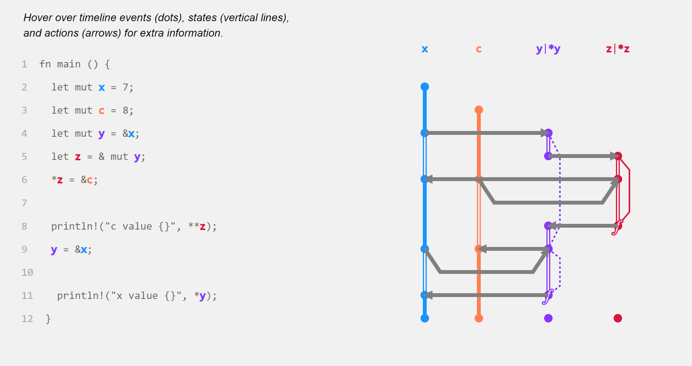

# RustViz

**RustViz** generates interactive timeline visualizations of ownership and
borrowing for short Rust programs. It is meant as a teaching aid: paste a
snippet and see exactly when each binding becomes the resource owner, when
references go in and out of scope, and which lines those events correspond
to.

This repository is now the compiler-integrated rewrite. Earlier
versions of RustViz, deployed in the classroom and described in [our VL/HCC 2022 paper](https://web.eecs.umich.edu/~comar/rustviz-vlhcc22.pdf), read hand-annotated source; this one plugs into `rustc`
directly and walks HIR/MIR, so the diagram reflects the real borrow
checker's view of the program rather than a hand-curated approximation.

> Looking for the original (annotation-based) RustViz? It lives on
> the [`rv1-final`](https://github.com/rustviz/rustviz/tree/rv1-final)
> branch and tag in this repo, with a matching
> [GitHub Release](https://github.com/rustviz/rustviz/releases/tag/rv1-final).

RustViz is a project of the [Future of Programming Lab](http://fplab.mplse.org/)
at the University of Michigan.

> **Try it live:** <https://rustviz.github.io/>



---

## Local setup

The CLI, mdbook preprocessor, and library all share a runtime
dependency on the rustc plugin built from this workspace, which links
against `rustc_private` and so requires a specific nightly toolchain.
You need [`rustup`](https://rustup.rs/). The fastest way to get a
working install is:

```sh
cargo install rustviz       # the `rustviz` CLI binary
rustviz init                # installs nightly-2026-05-01 + the plugin
```

`rustviz init` runs `rustup toolchain install nightly-2026-05-01` (with
the `rust-src`, `rustc-dev` and `llvm-tools-preview` components) and
then `cargo install`s `rustviz-plugin` from this repository's git, at
the default branch unless you pass `--plugin-rev`. Pass `--dry-run` to
see exactly what it would run, `--plugin-git` to install from a fork,
or `--skip-toolchain` / `--skip-plugin` to run one step only. See
`rustviz init --help` for the full flag list.

### Building from source

For working *on* RustViz. Besides `rustup` you need `node` 20+ (for
the playground frontend) and, optionally, Docker (for the playground's
sandboxed runner image).

```sh
git clone https://github.com/rustviz/rustviz
cd rustviz
cargo xtask setup
```

`cargo xtask setup` is the canonical bootstrap. From the workspace
root it:

1. runs `rustup show active-toolchain`, which installs the nightly
   pinned in [`rust-toolchain.toml`](rust-toolchain.toml)
   (nightly-2026-05-01) if it's missing;
2. `cargo install --path rustviz-plugin --locked`: the plugin
   (`cargo rv-plugin`, `rv-plugin-driver`);
3. `cargo install --path rustviz-cli --locked`: the `rustviz` CLI;
4. `npm install` + `npm run build` in `playground/frontend/` (the build
   pre-renders the playground's examples through the `rustviz` CLI just
   installed);
5. `cargo build --workspace --release`;
6. gets the `rustviz/rustviz-runner:latest` Docker image if it isn't
   already present (pulled from
   `ghcr.io/rustviz/rustviz-runner:latest`, or built from
   `playground/runner/Dockerfile` if the pull fails or you pass
   `--build-runner`). Skipped when Docker isn't running.

It does **not** install the mdBook preprocessor. To undo it, run `cargo
xtask uninstall` (see `--help` for what it touches and what it leaves
alone; by default it spares the rustup toolchain and the cargo
`target/` tree). The xtask driver is pure Rust, so it works the same
on Linux, macOS, and Windows.

The minimal manual alternative (no npm, no Docker), run from the
checkout so the pinned nightly is used:

```sh
rustup toolchain install nightly-2026-05-01 --profile minimal \
    --component rust-src,rustc-dev,llvm-tools-preview
cargo install --locked --path rustviz-plugin   # required by everything else
cargo install --locked --path rustviz-cli      # optional: the `rustviz` CLI
cargo install --locked --path mdbook-rustviz   # optional: the mdBook preprocessor
```

**Running the tests:**

```sh
cargo build --workspace --locked
cargo test --workspace --locked
```

The corpus tests in `rustviz-lib/tests/` (`corpus.rs`, `book.rs`, ...)
run the **installed** plugin (`cargo rv-plugin` on your `PATH`), not
the source tree. After changing the plugin, reinstall it with `cargo
install --locked --path rustviz-plugin` before running them, or they
silently test a stale build. On Windows, run `build` and `test` as
`--workspace --exclude rustviz` and then `-p rustviz` separately:
`rustviz` and `rustviz-cli` both produce a `rustviz` bin, and linking
both in one invocation fails with LNK1104 (CI does the same).

**Running the playground locally:** `cd playground && cargo run
--release`, then open <http://127.0.0.1:8080/>. Without Docker, set
`RV_RUNNER=local` (fine on your own machine, never on a public
deployment). See [`playground/README.md`](playground/README.md).

**Using your build in an mdBook** (for example a clone of the
[tutorial](https://github.com/rustviz/tutorial)): install the
preprocessor and plugin from the checkout as above, then run `mdbook
build` or `mdbook serve` in the book. The preprocessor renders through
whichever `cargo rv-plugin` is installed, as a local subprocess (the
default `RV_RUNNER=local` backend), so reinstall the plugin to see
your changes.

### Working from multiple checkouts in parallel

If you keep several clones around (e.g. one branch per agent or per
issue), they share `~/.cargo` by default — so `cargo xtask setup`'s
`cargo install` from each one races for `~/.cargo/bin/rustviz`, and
concurrent playground builds collide on the `rustviz/rustviz-runner`
docker tag. To isolate them, this repo ships an
[`.envrc.example`](.envrc.example) for [direnv](https://direnv.net/)
that gives each checkout its own `CARGO_HOME` (and optional knobs
for the docker tag and playground bind address):

```sh
brew install direnv
echo 'eval "$(direnv hook zsh)"' >> ~/.zshrc   # then restart your shell
cp .envrc.example .envrc
direnv allow
```

After that, any shell — and anything it launches, including `claude`
— inherits a per-clone cargo home automatically when you `cd` into
the checkout. The rustup toolchain stays shared across clones since
they all pin the same nightly.

---

## Four ways to use RustViz

### 1. The playground

The hosted playground lets you paste a snippet into a CodeMirror editor and
get back the visualization with no local install. Available at
<https://rustviz.github.io/>; the SPA loads from GitHub Pages
and the compile API is on Google Cloud Run. You can also run the same playground
locally — it's the [`playground/`](playground/) crate in this workspace.

The playground offers mdBook's five colour themes and starts in Navy
(dark); the choice is remembered in the browser.

See [`playground/README.md`](playground/README.md) for the local quick-start
and the operational notes for the production deploy.

### 2. The mdbook preprocessor

Embed RustViz visualizations directly in an [mdBook](https://rust-lang.github.io/mdBook/)
by tagging code blocks with ` ```rv ` instead of ` ```rust `. The
preprocessor compiles each snippet through the plugin at build time and
embeds the resulting SVGs in the rendered HTML, with tooltip glue for
hover-driven exploration.

```toml
# book.toml
[preprocessor.rustviz]
```

````markdown
```rv
fn main() {
    let s = String::from("hello");
    println!("{}", s);
}
```
````

The figures follow the book's theme (Light, Rust, Coal, Navy or Ayu).
See [`mdbook-rustviz/README.md`](mdbook-rustviz/README.md) for setup
instructions and `mdbook-rustviz/test-book/` for a small worked
example. The hands-on Rust tutorial at
<https://github.com/rustviz/tutorial> (deployed at
<https://rustviz.github.io/tutorial/>) is a full-scale example built
this way.

### 3. The command-line interface

For one-shot rendering of a single `.rs` file:

```sh
cargo install rustviz           # the `rustviz` binary
rustviz init                    # one-time: install nightly + plugin

rustviz svg foo.rs              # writes foo.code.svg + foo.timeline.svg
rustviz html foo.rs             # writes one self-contained HTML page
```

`svg` is for embedding into your own HTML/Markdown workflow. `html`
produces a single self-contained file with both SVGs inlined and the
tooltip JS embedded — opens in any browser, no server, no external
assets. See `rustviz init --help` for the bootstrap flags.

### 4. The Rust library

For programmatic SVG generation (e.g. wiring RustViz into your own
authoring pipeline), `rustviz-lib` exposes a small Rust API:

```rust
use rustviz_lib::Rustviz;

let rv = Rustviz::new(code)?;     // calls the plugin under the hood
fs::write("code.svg", rv.code_panel_string())?;
fs::write("timeline.svg", rv.timeline_panel_string())?;
```

A runnable example lives at
[`rustviz-lib/examples/render_to_files.rs`](rustviz-lib/examples/render_to_files.rs).
The crate's [API docs](rustviz-lib/src/lib.rs) cover the backends,
chosen with the `RV_RUNNER` env var: `local` (a subprocess on the host,
the default for library, CLI and mdBook use), `docker` (the sandboxed
`rustviz/rustviz-runner` image; the playground binary opts into it for
untrusted input) and `sandbox` (Cloud Run's per-request sandbox, used in
production).

---

## Repository layout

The workspace is organized around the four entry points above. Each
top-level directory:

| Path                  | Contents |
|-----------------------|----------|
| **`rustviz-plugin/`** | The rustc plugin — the heart of the project. Walks HIR/MIR for one source file of a crate (the crate root, `src/lib.rs` or `src/main.rs`, or another file chosen with `--file`; see [`rustviz-plugin/README.md`](rustviz-plugin/README.md#usage)) and prints the code-panel and timeline-panel SVGs on stdout, as one JSON object (`code_panel`, `timeline_panel`, `height`). Built on Will Crichton's `rustc_plugin` / `rustc_utils` crates (same family as Flowistry / Aquascope). Produces the `cargo-rv-plugin` and `rv-plugin-driver` binaries. Pinned to nightly-2026-05-01 via `rust-toolchain.toml`. Published to crates.io as **`rustviz-plugin`**. |
| **`rustviz-lib/`**    | User-facing Rust library. Exposes `Rustviz::new(code)` which shells out to the plugin and returns the two SVGs. The shared tooltip JS for hover behavior also lives here, exported as `rustviz_lib::HELPERS_JS`. Published to crates.io as **`rustviz-lib`**. |
| **`rustviz/`**        | The namesake crate: `cargo install rustviz` installs the `rustviz` CLI, and `rustviz = "2"` as a dependency re-exports `rustviz-lib`. A few lines of glue over `rustviz-cli` and `rustviz-lib`. Published to crates.io as **`rustviz`**. |
| **`rustviz-cli/`**    | The implementation of the `rustviz` command-line interface — `rustviz svg`, `rustviz html`, `rustviz init`. Wraps `rustviz-lib` with file I/O + self-contained-HTML output, plus a one-shot toolchain/plugin bootstrap (`init`). Exposes `rustviz_cli::run()`; its own binary is the same `rustviz` (so `cargo install rustviz-cli` still works). Published to crates.io as **`rustviz-cli`**. |
| **`mdbook-rustviz/`** | An [mdBook](https://rust-lang.github.io/mdBook/) preprocessor. Replaces ` ```rv ` fenced code blocks with embedded RustViz SVGs at build time. Includes a `test-book/` worked example. The full hands-on tutorial that uses it is in a [separate repo](https://github.com/rustviz/tutorial). Published to crates.io as **`mdbook-rustviz`**. |
| **`playground/`**     | The web playground: Actix-web backend + a Vite/React/CodeMirror frontend. Hosted at <https://rustviz.github.io/> with the compile API at <https://rustviz-api-816769776225.us-central1.run.app/>. The same binary works as an all-in-one server for local dev. The per-request Docker sandbox image, deploy artifacts, and security threat model all live alongside it under `playground/`. Not published to crates.io. |
| **`xtask/`**          | Cross-platform driver for `cargo xtask setup` / `cargo xtask uninstall`. Installs the plugin + CLI, builds the frontend, pulls/builds the docker runner image; the uninstall subcommand reverses each step (with optional `--toolchain` / `--target` / `--everything` flags). Replaces the legacy bash scripts so the workspace boots the same way on Linux, macOS, and Windows. Not published. |
| `scripts/`            | `bump-version.sh` synchronizes the version field across all five published crates' Cargo.toml files (and refreshes Cargo.lock); run before tagging a release, see "Releasing" below. `bump-nightly.sh` moves every pin of the nightly toolchain (see [`CLAUDE.md`](CLAUDE.md#bumping-the-toolchain)). `probe-diff.sh` diffs two plugin builds' tooltips over every fixture. |
| `.github/workflows/`  | CI (`build.yml`, which also deploys the compile API), the playground's GitHub Pages deploy (`pages.yml`) and the crates.io release (`publish.yml`). |

---

## Limitations

RustViz is a research tool. It only visualizes programs that compile (code
with a borrow-checker error is rejected with rustc's message), and it
handles a subset of Rust. The main gaps:

- **Closures:** captures are drawn, but what the closure body does when it
  runs isn't shown on the captured variables' timelines.
- **Macros:** standard macros like `println!` and `vec!` are handled; your
  own `macro_rules!` macros aren't.
- **Raw pointers and `async` code** aren't modelled.

See the [full list of known
limitations](https://github.com/rustviz/rustviz/issues?q=is%3Aissue+is%3Aopen+label%3Alimitation)
and the [known
crashes](https://github.com/rustviz/rustviz/issues?q=is%3Aissue+is%3Aopen+label%3Acrash)
(issues labelled `crash`). If you find a program RustViz gets wrong or can't
visualize, please [open an issue](https://github.com/rustviz/rustviz/issues/new)
with the snippet.

---

## Security

The playground compiles untrusted Rust source. Snippets are compiled as a
dependency-free library crate, so they can't run code at compile time
without a rustc bug, but rustc is a large attack surface: every request runs
in a per-request sandbox (Cloud Run's `sandbox do` in production, a locked-
down container locally). The full threat model and operator
checklist are in [`playground/SECURITY.md`](playground/SECURITY.md). Report findings to
`comar@umich.edu`.

---

## Contributing

Issues and PRs welcome. Keep each PR focused on a single concern; see
[Building from source](#building-from-source) for setup and tests.
[`CLAUDE.md`](CLAUDE.md) has the project's ground rules (for human and AI
contributors alike): tooltips must be semantically correct, tests must pin
correct behaviour, and known gaps are tracked as issues labelled
`limitation`.

CI also lints the plugin for iteration over a `HashMap` / `HashSet`, whose
order changes from run to run (#211). To run that lint locally:

```sh
rustup component add clippy
cargo clippy -p rustviz-plugin --locked -- -A clippy::all -D clippy::disallowed_methods -D clippy::iter_over_hash_type -D unfulfilled_lint_expectations
```

If the order can't reach the output (a sum, a set union, a lookup), mark
the statement with `#[expect(clippy::..., reason = "...")]`; otherwise sort
first or use a `BTreeMap` / `BTreeSet`.

## Releasing

Five crates are published to crates.io in lockstep, all sharing the
same version:

| Crate                                                            | What it is |
|------------------------------------------------------------------|------------|
| [`rustviz-plugin`](https://crates.io/crates/rustviz-plugin)      | The rustc plugin (binaries `cargo-rv-plugin` + `rv-plugin-driver`). |
| [`rustviz-lib`](https://crates.io/crates/rustviz-lib)            | Rust library: `Rustviz::new(code)` returns the SVGs. |
| [`rustviz-cli`](https://crates.io/crates/rustviz-cli)            | The CLI implementation and a `rustviz` binary (`svg`, `html`, `init`). |
| [`rustviz`](https://crates.io/crates/rustviz)                    | The namesake crate: `cargo install rustviz` for the CLI; as a library, re-exports `rustviz-lib`. |
| [`mdbook-rustviz`](https://crates.io/crates/mdbook-rustviz)      | The mdBook preprocessor. |

Versions follow `v2.Y.0` (major fixed at 2 to match RustViz 2; patch
fixed at 0 since the five crates always release together — bumping Y
covers everything from a typo fix to a breaking API change). To cut a
release:

```sh
# 1. Bump versions on a branch, open a PR, get it reviewed + merged.
./scripts/bump-version.sh         # auto-increment Y
# (or: ./scripts/bump-version.sh 5  to set v2.5.0 explicitly)
git checkout -b release/v2.5.0
git add -A && git commit -m 'Bump RustViz to v2.5.0'
git push -u origin release/v2.5.0
gh pr create --fill                # land it on main

# 2. Once the bump PR is merged, tag the merge commit and push the tag.
#    Merging the PR does NOT auto-tag — tagging is a separate, deliberate
#    step so you have a clean "yes, ship this" checkpoint.
git checkout main && git pull
git tag v2.5.0
git push origin v2.5.0
```

The pushed `v2.Y.0` tag triggers
[`.github/workflows/publish.yml`](.github/workflows/publish.yml), which
verifies all five manifests pin the tag's version and then publishes
them in dependency order (`rustviz-plugin` and `rustviz-lib` first,
then `rustviz-cli` and `mdbook-rustviz`, and `rustviz` last since it
depends on `rustviz-cli`). A `CRATES_IO_TOKEN` repo
secret with `publish-new` + `publish-update` scope on those five crate
names is required.

## Credits

RustViz is a project of the
[Future of Programming Lab](https://web.eecs.umich.edu/~comar/) at the
University of Michigan. The plugin is built on
[`rustc_plugin`](https://github.com/cognitive-engineering-lab/rustc_plugin) /
[`rustc_utils`](https://github.com/cognitive-engineering-lab/rustc_plugin)
by [Will Crichton](https://willcrichton.net/), and ports several
MIR / borrow-fact helpers from
[Aquascope](https://github.com/cognitive-engineering-lab/aquascope)
(another visualization tool for Rust) by
[Gavin Gray](https://gavinleroy.com/).

## License

[MIT](LICENSE).

## Citing

If you use RustViz in academic work, please cite the
[VL/HCC 2022 paper](https://web.eecs.umich.edu/~comar/rustviz-vlhcc22.pdf).
