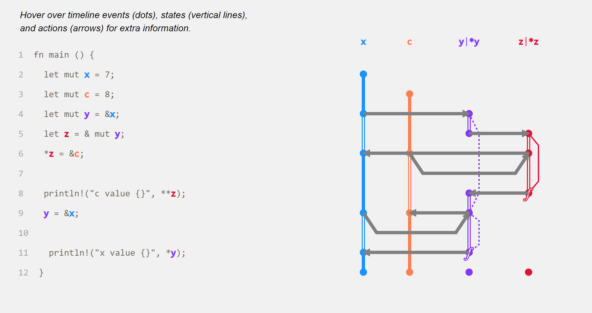

# rustviz-plugin

The compiler-integrated heart of [RustViz](https://github.com/rustviz/rustviz).
A `rustc_private` plugin that walks HIR/MIR for a single-file crate and
emits a code panel + timeline panel as SVGs on stdout. Built on Will
Crichton's [`rustc_plugin`](https://crates.io/crates/rustc_plugin) /
[`rustc_utils`](https://crates.io/crates/rustc_utils) crates (same
family as Flowistry / Aquascope).

End users typically don't touch this crate directly — they use one of:

- the **`rustviz` CLI** in [`rustviz-cli`](https://crates.io/crates/rustviz-cli) (`rustviz svg foo.rs`, `rustviz html foo.rs`),
- the **`mdbook-rustviz` preprocessor** in [`mdbook-rustviz`](https://crates.io/crates/mdbook-rustviz) (` ```rv ` fenced blocks),
- the **playground** in [`../playground/`](../playground/), or
- the **`rustviz-lib` Rust library** in [`rustviz-lib`](https://crates.io/crates/rustviz-lib).

Each of those routes calls into the binaries this crate produces
(`cargo-rv-plugin`, `rv-plugin-driver`).



## Installing

The standard install path is via the `rustviz` CLI's bootstrap, which
also installs the matching nightly toolchain:

```sh
cargo install rustviz-cli
rustviz init
```

To install from source against a local checkout:

```sh
rustup toolchain install nightly-2026-05-01 \
    --profile minimal \
    --component rust-src,rustc-dev,llvm-tools-preview
cargo install --path . --locked
```

## Usage

Run `cargo rv-plugin` in a crate directory (a lib crate with `src/lib.rs`,
or a bin crate with `src/main.rs`). By default it visualizes the crate
root, the file rustc compiles as `src/lib.rs` or `src/main.rs`.

To visualize another file of the crate, name it with `--file`, relative to
the crate directory:

```sh
cargo rv-plugin --file src/shapes.rs
```

The file must be one the crate compiles, e.g. `src/shapes.rs` declared with
`mod shapes;`. Only the functions in that file are drawn, and the code panel
shows that file. Otherwise the plugin exits 1 with
`src/foo.rs isn't compiled as part of this crate (check its `mod` declaration)`.

## When the plugin crashes

A panic inside the visitor is reported as a single rustc error line,

```text
error: rustviz: unsupported: RustViz can't visualize this program yet (internal error at visitor.rs:628: <panic message>). Please report it at https://github.com/rustviz/rustviz/issues with your snippet.
```

which `rustviz-lib` turns into an "unsupported" error (the playground,
CLI and mdbook preprocessor show it to the user). To get the stock panic
output with a backtrace while debugging, set `RUSTVIZ_DEBUG=1` or
`RUST_BACKTRACE=1`.

## Limitations

What RustViz can't draw correctly yet is tracked as [issues labelled
`limitation`](https://github.com/rustviz/rustviz/issues?q=is%3Aissue+is%3Aopen+label%3Alimitation);
known crashes are [issues labelled
`crash`](https://github.com/rustviz/rustviz/issues?q=is%3Aissue+is%3Aopen+label%3Acrash).
The checklist below is the plugin's implementation-level TODO list.

### To fix / implement

- [x] Handle owners that are declared inside conditional blocks
- [x] Typecheck function ctxt to determine what type of return annotation to make
- [x] Implement new state calculation system
- [ ] Remove struct members that are not utilized from the timeline
- [ ] Implement hoverable anonymous owner interactions in code panel
- [ ] Weird phantom annotated src bug that seems to appear when there are `\t` characters
- [ ] Add highlighting for passbyref events
- [x] Implement for-loops, while, while-let, loop, if-let — all loop / pattern-binding constructs
- [x] last (black) data-hash doesn't render properly
- [x] Fix resource dropping (breaks with conditionals)
- [x] Reference aliasing
- [x] Fix annotated source gen to handle `<` `/` `>` characters
- [ ] Let-if / match expressions (new conditional move event)
- [x] Conditional lifetime logic and visualization
- [x] Bad stuff happens when you don't put a semi-colon at the end of a void stmt at the end of a block
- [ ] Chained method calls (goes hand in hand with anonymous owner interactions, e.g. `.get().get_mut()`)
- [ ] Lifetimes that are 'captured' by conditional statements (use MIR)
- [ ] Struct box kind of buggy
- [ ] JSONify the output
