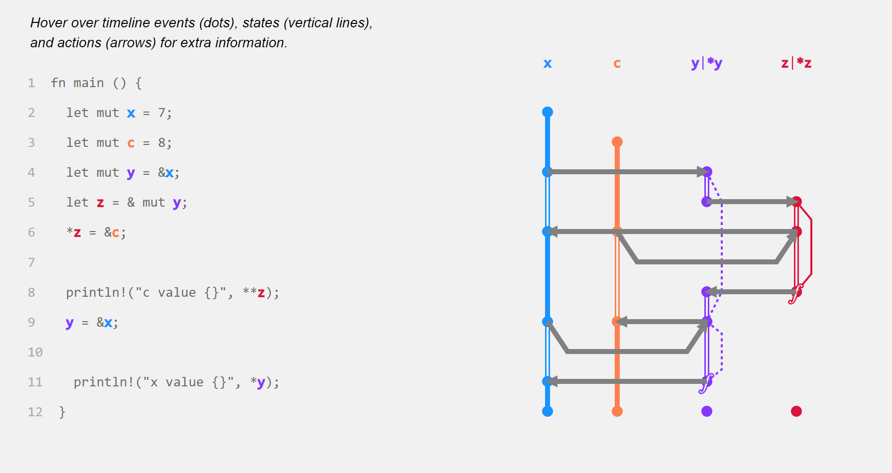

# rustviz-plugin

The compiler-integrated heart of [RustViz](https://github.com/rustviz/rustviz).
A `rustc_private` plugin that walks HIR/MIR for one source file of a crate
and prints a code panel + timeline panel SVG on stdout, as one JSON object
that [`rustviz-lib`](https://crates.io/crates/rustviz-lib) parses. Built on Will
Crichton's [`rustc_plugin`](https://crates.io/crates/rustc_plugin) /
[`rustc_utils`](https://crates.io/crates/rustc_utils) crates (same
family as Flowistry / Aquascope).

End users typically don't touch this crate directly — they use one of:

- the **`rustviz` CLI** in [`rustviz`](https://crates.io/crates/rustviz) (`rustviz svg foo.rs`, `rustviz html foo.rs`),
- the **`mdbook-rustviz` preprocessor** in [`mdbook-rustviz`](https://crates.io/crates/mdbook-rustviz) (` ```rv ` fenced blocks),
- the **playground** at <https://rustviz.github.io/> (source in [`playground/`](https://github.com/rustviz/rustviz/tree/main/playground)), or
- the **`rustviz-lib` Rust library** in [`rustviz-lib`](https://crates.io/crates/rustviz-lib).

Each of those routes calls into the binaries this crate produces
(`cargo-rv-plugin`, `rv-plugin-driver`).



## Installing

The standard install path is via the `rustviz` CLI's bootstrap, which
also installs the matching nightly toolchain:

```sh
cargo install rustviz
rustviz init
```

To install from source, from this directory of a
[checkout](https://github.com/rustviz/rustviz):

```sh
rustup toolchain install nightly-2026-05-01 \
    --profile minimal \
    --component rust-src,rustc-dev,llvm-tools-preview
cargo install --path . --locked
```

Working on RustViz itself? See [Building from
source](https://github.com/rustviz/rustviz#building-from-source) in the
main README.

## Usage

Run `cargo rv-plugin` in a crate directory (a lib crate with `src/lib.rs`,
or a bin crate with `src/main.rs`). By default it visualizes the crate
root, the file rustc compiles as `src/lib.rs` or `src/main.rs`.

To visualize another file of the crate, name it with `--file`, relative to
the crate directory:

```sh
cargo rv-plugin --file src/shapes.rs
```

The file must be one the crate compiles, e.g. `src/shapes.rs` declared with
`mod shapes;`. Only the functions in that file are drawn, and the code panel
shows that file. Otherwise the plugin exits 1 with
`src/foo.rs isn't compiled as part of this crate (check its `mod` declaration)`.

## Element ids

Every hoverable element of the timeline, and every numbered code line,
carries `data-rv-*` attributes (`data-rv-id="s@L9:dot:move"`,
`data-rv-kind`, `data-rv-event`, `data-rv-var`, `data-rv-line`, …), so a
client can tell which element was hovered without parsing tooltip text.
They change nothing that is drawn. See
[docs/element-ids.md](https://github.com/rustviz/rustviz/blob/main/rustviz-plugin/docs/element-ids.md)
for the id grammar and the kind, event and state vocabularies.

## When the plugin crashes

A panic inside the visitor is reported as a single rustc error line,

```text
error: rustviz: unsupported: RustViz can't visualize this program yet (internal error at visitor.rs:628: <panic message>). Please report it at https://github.com/rustviz/rustviz/issues with your snippet.
```

which `rustviz-lib` turns into an "unsupported" error (the playground,
CLI and mdbook preprocessor show it to the user). To get the stock panic
output with a backtrace while debugging, set `RUSTVIZ_DEBUG=1` or
`RUST_BACKTRACE=1`.

## Limitations

What RustViz can't draw correctly yet is tracked as [issues labelled
`limitation`](https://github.com/rustviz/rustviz/issues?q=is%3Aissue+is%3Aopen+label%3Alimitation);
known crashes are [issues labelled
`crash`](https://github.com/rustviz/rustviz/issues?q=is%3Aissue+is%3Aopen+label%3Acrash).
